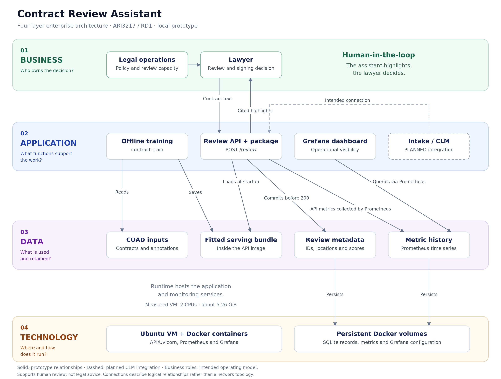

# RD1 — Four-layer enterprise architecture

## Scope

This is a local prototype of an online, human-in-the-loop contract-review
service. The API returns cited highlights; a lawyer retains responsibility
for reviewing the agreement and deciding what action to take.

Intake/CLM integration is an intended enterprise connection, not an
implemented integration. The current interface is HTTP JSON, exercised
through scripts, curl and interactive API documentation.

## Layer map

| Layer | Components and responsibilities |
|---|---|
| Business | Legal operations defines the review policy and capacity assumptions. A lawyer interprets the highlights and owns the review/signing decision. The notebook assumes approximately 40 contracts per month and a 20-passage review budget. |
| Application | FastAPI exposes health and review endpoints. The contract_review package masks contacts, chunks text, applies the saved extractor and selects highlights. contract-train handles offline training. Grafana presents operational measurements. Intake/CLM integration is planned. |
| Data | CUAD supplies training/evaluation text and annotations. The fitted bundle contains vocabulary, weighting, classifiers, calibration, knowledge-query vectors and review settings. SQLite records request IDs, timestamps, model versions, passage locations and scores. Prometheus retains metric history. |
| Technology | Docker Compose runs the API, Prometheus and Grafana on the Ubuntu VM. Uvicorn serves one API process. SQLite writes to a named external Docker volume. Prometheus and Grafana have separate persistent volumes. The measured deployment is Linux/arm64 with two CPUs and approximately 5.26 GiB available to Docker. |

## Deployment details

The dotted connection in the diagram marks the planned intake integration.
Prometheus scrapes the API, and Grafana queries Prometheus. The serving bundle
is packaged inside the API image. The review database, metric history and
Grafana configuration use separate Docker volumes.

## Request and decision responsibilities

1. A caller submits contract text to POST /review.
2. The service validates input, masks emails/phones without shifting offsets,
   chunks the text and scores it using the fitted bundle.
3. It selects up to the configured passage budget and prepares citations.
4. It commits minimised review metadata before returning HTTP 200.
   An unwritable database returns HTTP 503.
5. The lawyer interprets the highlights alongside the original agreement.
   “Not found in highlights” does not establish absence.
6. The operator uses monitoring to investigate availability, errors, latency
   and changes in submitted contract lengths.

The business roles are the proposed enterprise operating model; the current
prototype does not implement lawyer authentication, CLM integration or
capture of lawyers' corrections.

## Cross-layer consequence: healthy service, weak predictions

The operational dashboard does not have immediate ground-truth labels.
It can show low latency and successful requests while important clauses are
missed. The baseline's recall at 20 passages was approximately 88.02% on
regular test contracts and 53.33% on held-out franchise agreements.

Lawyers' corrections would provide delayed quality labels. This data-layer
delay means operational monitoring cannot establish live extraction recall.
A complete production design would need a feedback process, quality monitoring
and a route to fuller manual review. Those mechanisms are not implemented
by the current dashboard.

## Evidence

- [Rendered diagram at `270f0f1`](https://github.com/kurtabela06/ARI3217-Contract-Review/blob/270f0f16515ae9e1b41963e5fa2857322b02a09e/docs/images/contract-review-architecture.png).
- [Measured deployment at `282cf23`](https://github.com/kurtabela06/ARI3217-Contract-Review/blob/282cf23093d0d5cf9683987e991f2bfc2d6b7e34/evidence/sustained-load-deployment-summary.json), [storage recheck at `22152bf`](https://github.com/kurtabela06/ARI3217-Contract-Review/blob/22152bfae9ee2537a2c6c967f3b9e8347f861451/evidence/storage-recheck-summary.json).
- [Recall at 20 passages at `eb7b2f3`](https://github.com/kurtabela06/ARI3217-Contract-Review/blob/eb7b2f3f4992fdf95209a5cbd4bd96833b3e4e7e/evidence/baseline-operating-point-results.csv).
- [Compose configuration](../compose.monitoring.yaml), [Grafana configuration](../compose.grafana.yaml), [full evidence index](evidence-index.md).
